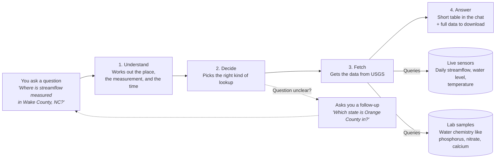
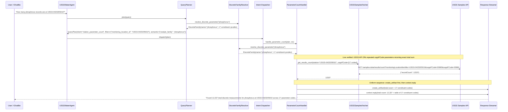
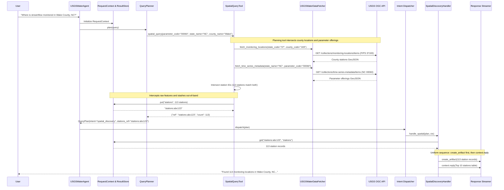

# USGS Water Agent: Architecture & Data Flow Specification

> **Document Version**: 2.6  
> **Last Updated**: 2026-10-30  
> **Status**: Current Production Reference  
> **Repository**: `usgs-water-agent`

---
## 1. System Overview

### 1.1 At a Glance

The USGS Water Agent answers plain-English questions about U.S. water data. It understands what you're asking, fetches the right data from the U.S. Geological Survey, and replies with a short summary plus a downloadable file of the full results.

**Two kinds of water data.** USGS collects water data in two ways, and the agent handles both:

| | Live sensors (continuous) | Lab samples (discrete) |
| :--- | :--- | :--- |
| **What it is** | Instruments in rivers that record automatically | Water collected by hand and analyzed in a lab |
| **How often** | Every day | Occasionally (weeks to years apart) |
| **Typical measurements** | Streamflow, water level, temperature | Nutrients, metals, minerals |

### 1.2 What You Can Ask

| Type of question | Example | What you get back |
| :--- | :--- | :--- |
| **Find stations** | "Where is streamflow monitored in Wake County, NC?" | List of monitoring stations in that area |
| **What a station measures** | "What does station USGS-0423205010 measure?" | Its sensor readings and lab tests |
| **How much data exists** | "How many phosphorus records are at USGS-0423205010?" | Total count and parameter breakdown |
| **Lab results** | "Show nitrate results at USGS-0423205010 for 2020" | Lab measurements with dates and units |
| **Daily sensor values** | "What was the daily streamflow at USGS-02087500 last month?" | Daily averages or maximums |
| **Not enough detail** | "Show me streamflow stations" | A follow-up question asking where |

### 1.3 Detailed Component Architecture *(for engineers)*

The USGS Water Agent is built with a decoupled, dual-modality architecture that coordinates automated sensor time-series with laboratory water quality sample observations. It exposes a single public entrypoint (`USGSWaterAgent`) to the overarching `IChatBio` system while isolating planning, business logic, resilience, and data access behind typed boundaries.

```mermaid
flowchart TD
    %% External Interfaces
    Client["IChatBio Platform / User"]
    USGS_OGC[("USGS OGC API v0<br/>Continuous Daily Sensors")]
    USGS_SAMPLES[("USGS Samples API<br/>Discrete Water Quality Lab Data")]
    
    %% Core Agent Entrypoint
    subgraph core["Core Entrypoint & Planning"]
        Agent["USGSWaterAgent<br/>Main Entrypoint"]
        Context["RequestContext & ResultStore<br/>Request-Scoped In-Memory Store"]
        Planner["QueryPlanner<br/>LLM Tool Loop with Reasoning Sanitizer"]
        Tools["Planning Tools<br/>SpatialQueryTool, StationInventoryTool"]
        Dispatcher["Intent Dispatcher<br/>Routes on QueryPlan.intent"]
    end

    %% Execution Handlers
    subgraph handlers["Execution Handler Layer"]
        H_Spatial["SpatialDiscoveryHandler"]
        H_Inventory["StationInventoryHandler"]
        H_Count["ParameterCountHandler"]
        H_Obs["ObservationHandler<br/>Branches on plan.modality"]
        H_Clarify["ClarificationHandler"]
    end

    %% Metadata & Resolvers
    subgraph resolvers["Metadata Resolvers & Reference DB"]
        Resolver_Ref["ReferenceResolver<br/>FIPS & Daily Queryables"]
        Resolver_Families["DiscreteFamilyResolver<br/>Unified Analyte Index: 25 Families"]
        RefStore[("Local Reference DB<br/>counties.json, state-identifiers.json,<br/>discrete_families.json, etc.")]
    end

    %% Data Access Layer with Circuit Breakers
    subgraph resilience["Resilient Data Access Layer"]
        CB_OGC{{"Circuit Breaker<br/>usgs_ogc_api"}}
        CB_Samples{{"Circuit Breaker<br/>usgs_samples_api"}}
        Fetcher_OGC["USGSWaterDataFetcher<br/>PagedResult GeoJSON Streamer"]
        Fetcher_Samples["USGSSamplesFetcher<br/>CSV Streamer, Count Guard, Partitioning"]
    end

    %% Client Interactions & Planning
    Client -->|"Natural Language Query"| Agent
    Agent -->|"Initializes Request-Scoped Context"| Context
    Agent -->|"Plan Query"| Planner
    Planner -->|"Resolve Geographic Terms"| Resolver_Ref
    Planner -->|"Resolve Analyte Families"| Resolver_Families
    Resolver_Ref --> RefStore
    Resolver_Families --> RefStore

    %% Planning Phase: Tools query fetchers and stash out-of-band
    Planner -->|"Execute Tool Call"| Tools
    Tools -.->|"Runtime FIPS Resolution"| Resolver_Ref
    Tools --> Fetcher_OGC
    Tools --> Fetcher_Samples
    Tools -->|"Stash Full Datasets & Return Handle"| Context

    %% Dispatcher Phase
    Planner -->|"Typed QueryPlan with Handles"| Agent
    Agent -->|"Pass Plan & Context"| Dispatcher
    Dispatcher -->|"Workflow 1: SPATIAL_DISCOVERY"| H_Spatial
    Dispatcher -->|"Workflow 2: STATION_INVENTORY"| H_Inventory
    Dispatcher -->|"Workflow 3: STATION_PARAMETER_COUNT"| H_Count
    Dispatcher -->|"Workflows 4 & 5: OBSERVATION"| H_Obs
    Dispatcher -->|"Workflow 6: CLARIFICATION"| H_Clarify

    %% Execution Handlers Runtime Resolution
    H_Inventory -.->|"Runtime Family Expansion"| Resolver_Families
    H_Count -.->|"Runtime Family Expansion"| Resolver_Families
    H_Obs -.->|"Runtime Family Expansion"| Resolver_Families

    %% Clarification Short-Circuit (Zero API Calls)
    H_Clarify -.->|"Clarifying Question / Guardrail Prompt"| Response["Response Streamer<br/>create_artifact then context.reply"]

    %% Execution Phase Fetching (Workflows 3, 4, 5)
    H_Count -->|"Count-First Query Only"| Fetcher_Samples
    H_Obs --> Fetcher_OGC
    H_Obs --> Fetcher_Samples

    %% Upstream Fetching through Circuit Breakers
    Fetcher_OGC --> CB_OGC
    CB_OGC -->|"HTTP GET"| USGS_OGC
    Fetcher_Samples --> CB_Samples
    CB_Samples -->|"HTTP GET / Streaming CSV"| USGS_SAMPLES

    %% Circuit Breaker Fast-Fail Outage Recovery
    CB_OGC -.->|"CircuitBreakerOpenError: Fast-Fail Abort"| Agent
    CB_Samples -.->|"CircuitBreakerOpenError: Fast-Fail Abort"| Agent

    %% Unpack Stashed Data from Planning Phase (Workflows 1 & 2)
    Context -.->|"Read Stashed Stations via Handle"| H_Spatial
    Context -.->|"Read Stashed Inventory via Handle"| H_Inventory
    H_Obs -->|"Stash Raw Observations & Link Artifact ID"| Context

    %% Output Synthesis & Artifacts (Uniform: create_artifact then context.reply)
    H_Spatial --> Response
    H_Inventory --> Response
    H_Count --> Response
    H_Obs --> Response
    Response -->|"Rendered Markdown & Downloadable Artifacts"| Client
```

### 1.4 Architectural Nuances & Design Decisions

1. **Request Lifecycle, Context Protection & State Trade-offs**:
   * `RequestContext` and its internal `ResultStore` are strictly **request-scoped in-memory structures** instantiated with a unique UUID on each user turn (`RequestContext(request_id=str(uuid.uuid4()))`).
   * **Dual Stashing Benefit**:
     1. *During Planning*: The planner's tool execution loop intercepts large API outputs (e.g., 100+ station GeoJSON features from `spatial_query` or extensive parameter catalogs from `station_inventory`), caches them in `ResultStore`, and returns only a compact `ResultHandle` (ref, count, sample preview) to the LLM. This prevents prompt truncation and context-window exhaustion during multi-turn tool loops.
     2. *During Execution*: Handlers stash full observation datasets out-of-band, formatting a concise top-10 preview table for chat while packaging complete records into a downloadable JSON artifact, protecting the chat stream UI from multi-megabyte Markdown payloads.
   * *State Trade-off*: Because the store is discarded at the end of each request to guarantee zero cross-request memory leaks, opaque handles (`stations_ref`, `inventory_ref`) cannot be referenced across follow-up conversation turns (e.g., *"now show water quality for those stations"* initiates a fresh query).

2. **Clarification Handler Short-Circuit**:
   * `ClarificationHandler` operates without making any network calls to upstream USGS APIs. When missing geography (e.g., *"streamflow stations"*) or ambiguous multi-candidate entities (e.g., *"Orange County"* without a state) are detected, it short-circuits execution and delivers a clarifying question directly to the user via `context.reply()`.

3. **Planning Tools vs. Execution Handlers (Who Fetches Data?)**:
   * **Workflows 1 (Spatial Discovery) and 2 (Station Inventory)** perform their network fetches during the **Planning Phase** via tools (`SpatialQueryTool`, `StationInventoryTool`). These tools invoke `ReferenceResolver` (for FIPS codes), call the fetchers, stash the raw payloads in `ResultStore`, and supply compact handles (`stations_ref`, `inventory_ref`) to the `QueryPlan`. Their downstream execution handlers (`SpatialDiscoveryHandler`, `StationInventoryHandler`) simply unpack those handles from `ResultStore` to format the chat preview and emit artifacts without re-querying USGS.
   * **Workflows 3 (Parameter Counts) and 4/5 (Observations)** perform their primary network fetches during the **Execution Phase** directly inside `ParameterCountHandler` and `ObservationHandler`, calling `DiscreteFamilyResolver` at runtime to expand analyte families into constituent codes.

4. **Modality Separation for Counts**:
   * The agent explicitly reserves per-parameter record count workflows (`station_parameter_count`) for discrete laboratory data via the dedicated `/samples-data/results/count` endpoint. Continuous sensor time-series are queried via daily observation workflows, as discrete laboratory sampling requires explicit count verification prior to multi-megabyte CSV downloads.

5. **Circuit Breaker Resilience & Outage Path**:
   * Upstream fetchers run behind independent `CircuitBreaker` instances (`usgs_ogc_api` and `usgs_samples_api`).
   * If an upstream service experiences 5 consecutive failures, the breaker transitions to `OPEN`.
   * When `OPEN`, calls fast-fail immediately with `CircuitBreakerOpenError(service_name, retry_after)`. The Agent catches this exception, immediately aborts the request rather than hanging on network sockets, and returns an informative degraded service notice to the user.
   * *Modality Isolation Scope*: Isolating the backends ensures that for single-modality workflows, an outage on continuous sensors does not degrade discrete queries (and vice versa). For dual-modality Workflow 2 (`station_inventory`), an outage on either backend currently aborts the request with an explicit notice identifying the failed service; graceful single-backend degradation for inventory is a future enhancement.

6. **Sequential Output Generation (create_artifact then context.reply)**:
   * Across all data-returning handlers (Workflows 1–5), response generation follows a uniform sequential pattern:
     1. `await process.create_artifact(...)` packages the complete dataset retrieved from `ResultStore` or fetchers into an immutable JSON artifact.
     2. `await context.reply(...)` streams a concise Markdown summary table (e.g., top 10 stations or most recent 10 observations) into the chat stream, allowing the user to inspect the full dataset without token clutter.

7. **Intent Routing vs. Modality Branching**:
   * The `Dispatcher` routes requests primarily on `QueryPlan.intent`. For `QueryIntent.OBSERVATION`, a single handler (`ObservationHandler`) handles both continuous daily sensor values (Workflow 5) and discrete laboratory samples (Workflow 4) by branching internally on `QueryPlan.modality` (`"continuous"` vs. `"discrete"`). Modality `"mixed"` is specific to Workflow 2 (`station_inventory`), where a single station monitors both continuous sensor time series and discrete laboratory characteristics.

---

## 2. The 6 Core Execution Workflows

The agent classifies natural-language queries into 6 typed execution workflows:

| Workflow | Intent Enum | Modality | Primary Upstream Endpoint(s) | Key Handling Logic |
| :--- | :--- | :--- | :--- | :--- |
| **1. Spatial Discovery** | `spatial_discovery` | `continuous` \| `discrete` | Continuous: `/collections/monitoring-locations/items` intersected with `/collections/time-series-metadata/items` Discrete: `/samples-data/locations` | Geographic constraint required (state/county). Stashes large station sets out-of-band (`stations_ref`). 0 stations is a definitive valid outcome. |
| **2. Dual Station Inventory** | `station_inventory` | `mixed` | OGC `/collections/time-series-metadata/items` + Samples `/samples-data/summary/{station}` | Queries continuous sensor offerings AND discrete laboratory analytical catalogs for a specific station. |
| **3. Station Parameter Counts** | `station_parameter_count` | `discrete` | Samples `/samples-data/results/count` | Expands analyte families into all constituent `major_pcodes` (e.g., 17 codes for phosphorus, 4 for calcium). Supports repeated `usgsPCode` query parameters. |
| **4. Discrete Observation Values** | `observation` | `discrete` | Samples `/samples-data/results/narrow` | Streams laboratory measurements as CSV; projects dates, fractions, values, and units into tabular view. |
| **5. Continuous Daily Values** | `observation` | `continuous` | OGC `/collections/daily/items` | Queries sensor streamflow (`00060`), gage height (`00065`), or temperature (`00010`) by statistic (`00003` mean, `00001` max). |
| **6. Clarification Guardrails** | `clarification` | `None` | *None (zero API calls)* | Triggered when geographic constraints are missing or multi-candidate ambiguities exist (e.g. Orange County without state). |

---

## 3. Detailed Data Flow Diagrams

### Data Flow 1: Discrete Observation Counts (Multi-PCode Family Expansion)

This flow illustrates how user queries for broad chemical analytes (e.g. *"How many phosphorus records are at USGS-0423205010?"*) are expanded across all constituent codes and aggregated via repeated query parameters.

---

### Data Flow 2: Out-of-Band State Stashing (`ResultStore`)

Massive datasets (thousands of stations or observations) are intercepted and held in memory via `ResultStore`. The LLM planner only sees opaque references (`stations_ref`), preventing context-window exhaustion and token truncation.

---

## 4. Resilience & Reliability Architecture

### 1. Circuit Breakers (`CircuitBreaker`)
Both upstream data clients (`USGSWaterDataFetcher` and `USGSSamplesFetcher`) are guarded by circuit breakers implementing the state machine:
$$\text{CLOSED} \xrightarrow{\text{5 consecutive failures}} \text{OPEN} \xrightarrow{\text{30s cooldown}} \text{HALF-OPEN}$$
$$\text{HALF-OPEN} \xrightarrow{\text{1 successful probe}} \text{CLOSED}$$
$$\text{HALF-OPEN} \xrightarrow{\text{1 failed probe}} \text{OPEN}$$

* **Outage Fast-Fail**: While `OPEN`, any attempt to query upstream fails immediately with `CircuitBreakerOpenError(service_name, retry_after)`. The Agent catches this exception, aborts the request immediately rather than hanging on network sockets, and returns an informative degraded service notice to the user, protecting downstream event loops and connection pools from exhaustion.
* **Failure Classification**: Socket timeouts (`httpx.TimeoutException`, `httpx.TransportError`) and HTTP 5xx errors (`500`, `502`, `503`, `504`) are classified as service failures and trip the breaker.
* **Excluded Exceptions**: 4xx errors other than 429 (e.g. `USGSValidationError`, `USGSNotFoundError`) represent caller errors, not upstream outages, and never trip the breaker.
* **Rate Limits (HTTP 429)**: HTTP 429 responses are intercepted by client-level exponential backoff retries (respecting `Retry-After` headers, up to 3 attempts). They are treated as backoff signals rather than hard outages, and only count toward circuit breaker failures if all retry attempts are exhausted.

### 2. Provider Reasoning Token Sanitization
When using reasoning models (e.g. `gpt-5.6-luna`), Azure OpenAI emits server-encrypted reasoning tokens (`reasoning_items`, `reasoning_content`). LiteLLM load balancing across multi-region Azure endpoints rejects subsequent turns with a `400 Bad Request` if these tokens cannot be decrypted by the secondary instance.
* `_clean_message_payload()` in `src/water_agent/query_planner.py` automatically strips these fields prior to dispatching multi-turn messages.
* **Architectural Trade-off**: Stripping reasoning tokens removes the model's scratchpad chain-of-thought between tool loop iterations, but is necessary to prevent hard 400 routing failures across multi-region load-balanced deployments.

### 3. Client Timeout Hardening & Guard Thresholds
* **Socket Timeouts**: Defensively configured with `timeout=15.0` (continuous) and `timeout=20.0` (discrete streaming). Note that `httpx.Timeout` governs per-operation socket gaps (connect/read/write), not total multi-page request duration.
* **Per-Call LLM Timeout**: `AsyncOpenAI` client is bounded by `timeout=45.0` per completion turn (with `MAX_TOOL_ITERATIONS = 5`), bounding individual LLM inference calls rather than imposing an overall planning loop deadline.
* **Count-First Guard & Hierarchical Partitioning**:
  Before downloading laboratory datasets, `USGSSamplesFetcher` queries `/samples-data/results/count` against a safety ceiling of `MAX_RESULTS_THRESHOLD = 25,000` records:
  1. **Direct Stream**: If count $\le 25,000$, streamed directly via a single CSV batch.
  2. **Statewide Overflow**: If a statewide query exceeds 25,000 records, the fetcher partitions across county FIPS codes.
  3. **County / Station Temporal Overflow**: If a county or single-station query exceeds 25,000 records, the fetcher bypasses geographic division and partitions directly into annual or multi-year temporal chunks.
  4. **Unsplittable Ceiling**: If an individual unsplittable partition (e.g. a single year at a single high-frequency location) still exceeds 25,000 records, the fetcher raises `SamplesOverflowError` instructing the user to narrow their query.
  * *Partitioning Scope & Memory Boundary*: The 25,000-record threshold bounds individual HTTP streaming downloads and API buffer limits, not total aggregate request size across partitions (see [Section 6](#6-known-limitations--trade-offs) for the memory trade-off).

---

## 5. Architectural Invariants

1. **Spatial Invariant Rule**: For spatial queries of parameter families, the agent always performs a **union** of stations across all constituent codes in that family, never selecting an arbitrary single code.
2. **Modality Disclosure Rule**: All discrete sample responses must explicitly disclose that measurements represent discrete lab samples (not continuous sensors) and identify the sample media (e.g. Water).
3. **Count-First Guard**: Before streaming discrete record narrow profiles, the agent queries `/samples-data/results/count` to bound individual streaming downloads and decide whether to partition.

---

## 6. Known Limitations & Trade-offs

For operational clarity, the architectural trade-offs identified across the system are consolidated below:

1. **Per-Call vs. Loop-Level LLM Timeout**: `AsyncOpenAI` enforces a defensive `timeout=45.0` per completion turn. While `MAX_TOOL_ITERATIONS = 5` caps the number of loop iterations, there is currently no outer wall-clock deadline wrapping the entire planning loop.
2. **Download vs. Aggregate Memory Boundary**: The 25,000-record threshold protects individual HTTP streaming downloads and API buffer limits from socket timeouts and silent truncation. However, because all partitions are aggregated in memory within `ResultStore` and serialized into a single JSON artifact, broad multi-decade queries across multiple counties can still accumulate significant memory.
3. **Dual-Modality Outage Abort**: For Workflow 2 (`station_inventory`), an upstream outage on either continuous or discrete backends causes a fast-fail abort for the entire request, rather than returning a partial single-backend catalog.
4. **Request-Scoped Turn Boundary**: `ResultStore` and its opaque handles (`stations_ref`, `inventory_ref`) are discarded at the end of each request to guarantee zero cross-request memory leaks; subsequent conversational turns cannot reference prior handles without re-querying.
5. **Reasoning Token Stripping**: Server-encrypted reasoning tokens from models like `gpt-5.6-luna` are stripped between tool iterations to avoid `400 Bad Request` routing errors on multi-region load balancers, causing the model to lose intermediate scratchpad reasoning across turns.
