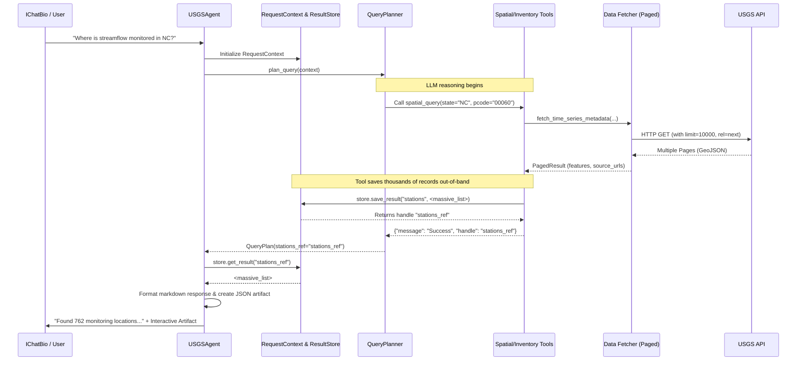
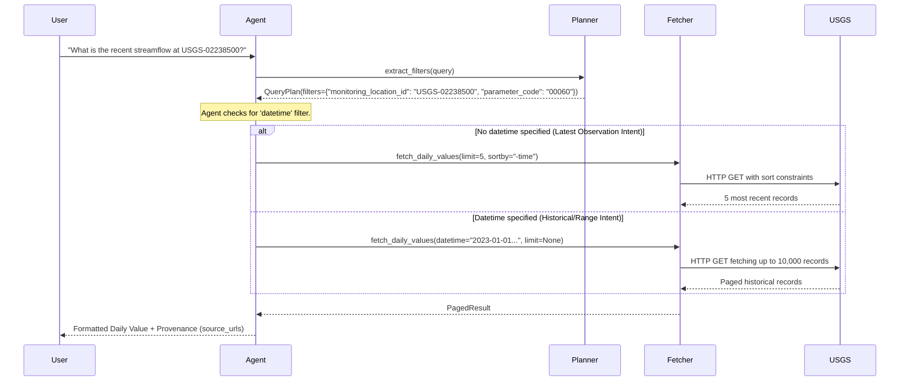

# USGS Water Agent Architecture

Here is the high-level architecture of the USGS Water Agent project. It adheres to the constraint of exposing a **single public entrypoint** (`USGSAgent`) to the overarching `IChatBio` system, while orchestrating various internal components behind the scenes.

```mermaid
flowchart TD
    %% External Interfaces
    Client[IChatBio / End User] 
    USGS_API[(USGS OGC APIs v0)]
    
    %% Main Entrypoint
    subgraph Core System
        Agent[USGSAgent]
        Context[RequestContext & ResultStore]
        Planner[QueryPlanner]
    end

    %% Agent Tools
    subgraph Tool Layer
        Spatial[SpatialQueryTool]
        Inventory[StationInventoryTool]
        RefResolver[ReferenceResolverTool]
    end
    
    RefDB[(Local Reference DB)]

    %% Data Access Layer
    subgraph Data Layer
        Fetcher[USGSWaterDataFetcher<br/>Returns PagedResult]
    end

    %% Relationships
    Client -->|Natural Language Query| Agent
    Agent -->|Initializes| Context
    Agent -->|Execute| Planner
    
    Planner -->|Provides Tools| RefResolver
    Planner -->|Provides Tools| Spatial
    Planner -->|Provides Tools| Inventory
    
    RefResolver -->|Semantic Mapping| RefDB
    
    Spatial -->|Fetch Metadata| Fetcher
    Inventory -->|Fetch Metadata| Fetcher
    Agent -->|Direct Fetch (Daily Obs)| Fetcher
    
    Spatial -->|Stash Large Results| Context
    Inventory -->|Stash Large Results| Context
    Context -->|Retrieve Stashed Results| Agent
    
    Fetcher -->|HTTP GET (Paginated)| USGS_API
    
    Agent -->|Structured Output & Artifacts| Client
```

---

## Data Flow Diagram: Out-of-Band State Stashing

The following sequence diagram illustrates the data flow for a request resulting in massive payloads (e.g., thousands of stations from a Spatial Query). It highlights the `ResultStore` and `RequestContext` patterns that prevent the LLM from hallucinating or truncating large datasets by keeping them strictly out-of-band.



## Data Flow Diagram: Intent Routing for Daily Values

The agent dynamically routes daily observational queries (which bypass the planner's tools) directly to the fetcher based on detected temporal constraints.



## Key Architectural Decisions
1. **Single Entrypoint (`USGSAgent`)**: Hides all API complexity. The external system simply passes strings and receives cleanly formatted Markdown and standard Artifacts.
2. **Out-of-Band Results (`ResultStore`)**: Massive API payloads are intercepted by the executing tools and saved to a short-lived memory store. The LLM only ever sees opaque handles (e.g., `stations_ref`), preventing context-window exhaustion and output hallucination.
3. **Data Fetcher (`USGSWaterDataFetcher`)**: Centralizes HTTP requests, transparent pagination (`_fetch_all_pages`), field selection optimization (`properties=`, `skipGeometry=true`), and rate-limit handling for all endpoints.
4. **Intent Segmentation**: Tool usage is strictly bounded. The planner is *only* responsible for spatial discovery and inventory lookups; direct daily value retrieval is structurally enforced in `agent.py` based on the planner's output filters, resolving ambiguity around temporal limits.
