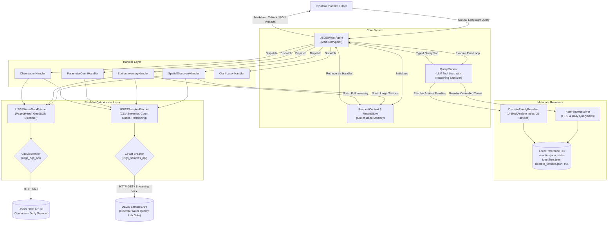
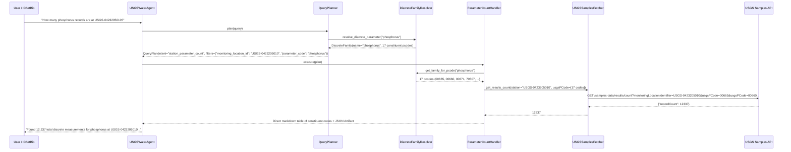
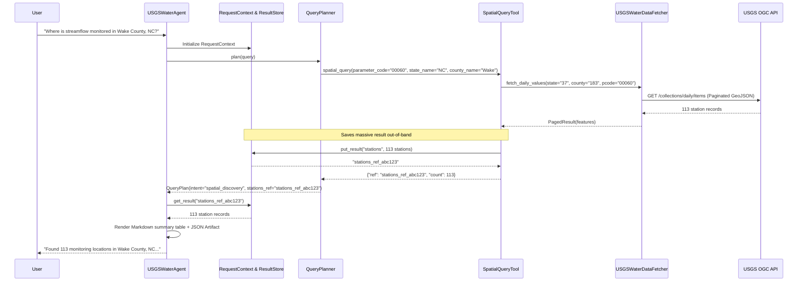

# USGS Water Agent: Architecture & Data Flow Specification

> **Document Version**: 2.0  
> **Last Updated**: 2026-10-29  
> **Status**: Current Production Reference  
> **Repository**: `usgs-water-agent`

---

## 1. High-Level System Architecture

The USGS Water Agent is built with a decoupled, dual-modality architecture that coordinates automated sensor time-series with laboratory water quality sample observations. It exposes a single public entrypoint (`USGSWaterAgent`) to the overarching `IChatBio` system while isolating planning, business logic, resilience, and data access behind typed boundaries.

---

## 2. The 5 Core Workflows

The agent classifies natural-language queries into 5 typed execution workflows (plus clarification guardrails):

| Workflow | Intent Enum | Modality | Primary Upstream Endpoint | Key Handling Logic |
| :--- | :--- | :--- | :--- | :--- |
| **1. Spatial Discovery** | `spatial_discovery` | `continuous` \| `discrete` | OGC `/collections/daily/items` or Samples `/locations` | Geographic constraint required (state/county). Stashes large station sets out-of-band (`stations_ref`). 0 stations is a definitive valid outcome. |
| **2. Dual Station Inventory** | `station_inventory` | `mixed` | OGC `/collections/daily/items` + Samples `/summary/{station}` | Queries continuous sensor offerings AND discrete laboratory analytical catalogs for a specific station. |
| **3. Station Parameter Counts** | `station_parameter_count` | `discrete` | Samples `/samples-data/results/count` | Expands analyte families into all constituent `major_pcodes` (e.g., 17 codes for phosphorus, 4 for calcium). |
| **4. Discrete Observation Values** | `observation` | `discrete` | Samples `/samples-data/results/narrow` | Streams laboratory measurements as CSV; projects dates, fractions, values, and units into tabular view. |
| **5. Continuous Daily Values** | `observation` | `continuous` | OGC `/collections/daily/items` | Queries sensor streamflow (`00060`), gage height (`00065`), or temperature (`00010`) by statistic (`00003` mean, `00001` max). |
| **6. Clarification Guardrails** | `clarification` | `None` | *None (zero API calls)* | Triggered when geographic constraints are missing or multi-candidate ambiguities exist (e.g. Orange County without state). |

---

## 3. Detailed Data Flow Diagrams

### Data Flow 1: Discrete Observation Counts (Multi-PCode Family Expansion)

This flow illustrates how user queries for broad chemical analytes (e.g. *"How many phosphorus records are at USGS-0423205010?"*) are expanded across all constituent codes and aggregated.

---

### Data Flow 2: Out-of-Band State Stashing (`ResultStore`)

Massive datasets (thousands of stations or observations) are intercepted and held in memory via `ResultStore`. The LLM planner only sees opaque references (`stations_ref`), preventing context-window exhaustion and token truncation.

---

## 4. Resilience & Reliability Architecture

### 1. Circuit Breakers (`CircuitBreaker`)
Both upstream data clients (`USGSWaterDataFetcher` and `USGSSamplesFetcher`) are guarded by circuit breakers implementing the state machine:
$$\text{CLOSED} \xrightarrow{\text{5 consecutive failures}} \text{OPEN} \xrightarrow{\text{30s cooldown}} \text{HALF-OPEN} \xrightarrow{\text{1 successful probe}} \text{CLOSED}$$

* **Outage Fast-Fail**: While `OPEN`, any attempt to query upstream fails immediately with `CircuitBreakerOpenError`, protecting downstream thread pools from latency death spirals.
* **Excluded Exceptions**: 4xx client errors (e.g. `USGSValidationError`, `USGSNotFoundError`) do not trip the breaker.

### 2. Provider Reasoning Token Sanitization
When using reasoning models (e.g. `gpt-5.6-luna`), Azure OpenAI emits server-encrypted reasoning tokens (`reasoning_items`, `reasoning_content`). LiteLLM load balancing across Azure endpoints rejects subsequent turns with a `400 Bad Request` if these tokens cannot be decrypted by the secondary instance.
* `_clean_message_payload()` in [`query_planner.py`](file:///c:/Users/shaik/OneDrive/Desktop/Github/usgs-water-agent/src/water_agent/query_planner.py) automatically strips these fields prior to dispatching multi-turn messages.

### 3. Client Timeout Hardening
To eliminate indefinite socket hangs in restricted or high-latency network topologies:
* `AsyncOpenAI`: Configured with defensive `timeout=45.0`.
* `httpx.AsyncClient`: Configured with `timeout=15.0` (continuous) and `timeout=20.0` (discrete streaming).

---

## 5. Architectural Invariants

1. **Spatial Invariant Rule**: For spatial queries of parameter families, the agent always performs a **union** of stations across all constituent codes in that family, never selecting an arbitrary single code.
2. **Modality Disclosure Rule**: All discrete sample responses must explicitly disclose that measurements represent discrete lab samples (not continuous sensors) and identify the sample media (e.g. Water).
3. **Count-First Guard**: Before streaming massive discrete record narrow profiles, the agent queries `/results/count` to guard against unbounded memory allocation.
