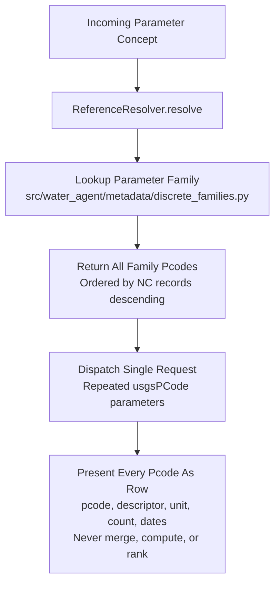

# System Architecture & Data Flow Specification

**System:** `usgs-water-agent`  
**Version:** 2.1 (Simplification Slice: Flat Catalog & Present-Don't-Decide Contract)  
**Date:** 2026-10-14  
**Status:** Authoritative  

---

## 1. System Overview & Entrypoint

The `usgs-water-agent` is an intelligent assistant built on the **iChatBio** multi-agent runtime. It translates natural-language inquiries regarding United States Geological Survey (USGS) hydrology and water quality into deterministic, schema-validated API queries across two primary backend modalities:

1. **Continuous Time-Series & Sensor Network:** Hosted on the modern **USGS Water Data OGC API** (`https://api.waterdata.usgs.gov/ogcapi/v0/`). Provides sensor observations (streamflow, gage height, continuous temperature) updated at 15-minute to daily intervals.
2. **Discrete Sample & Laboratory Network:** Hosted on the **USGS Samples API** (`https://api.waterdata.usgs.gov/samples-data/`). Provides physical water quality samples, laboratory analyses, and constituent concentrations (calcium, nutrients, metals, suspended solids) collected across decadal monitoring programs.

### 1.1 Invariant Public Surface
The agent exposes a single stable public entrypoint conforming to the iChatBio specification:
- **Class:** `USGSWaterAgent` (`src/agent.py`)
- **Primary Entrypoint:** `query_water_data`
- **Backward-Compatible Alias:** `answer_daily_query`
- **Method Signature:** `run(context: ResponseContext, request: str, entrypoint: str, params: Optional[BaseModel], metadata: dict | None)`

---

## 2. Component Architecture Diagram

```mermaid
graph TD
    User([User / iChatBio Client]) -->|Natural Language Query| Agent[USGSWaterAgent\nsrc/agent.py]
    
    subgraph Agent Runtime
        Agent -->|Initialize| ReqCtx[RequestContext\nUUID Session & ResultStore]
        Agent -->|Invoke| Planner[QueryPlanner\nsrc/water_agent/query_planner.py]
        
        subgraph Planner Toolset
            Planner -->|1. Queryables| QTool[QueryableSearchTool]
            Planner -->|2. Search Reference| RefSearch[ReferenceSearchTool]
            Planner -->|3. Resolve Reference| RefResolve[ReferenceResolveTool]
            Planner -->|4. Spatial Query| SpatialTool[SpatialQueryTool]
            Planner -->|5. Station Inventory| InvTool[StationInventoryTool]
        end
        
        RefSearch --> Resolver[ReferenceResolver\nsrc/water_agent/metadata/resolver.py]
        RefResolve --> Resolver
        Resolver --> RefStore[(ReferenceStore\nmetadata/raw/references/)]
        Resolver --> DiscFamilies[(Discrete Families Catalog\nsrc/water_agent/metadata/discrete_families.py)]
    end

    subgraph Tool-Level Deterministic Routing
        SpatialTool -->|Discrete / Mixed-Modality Parameter| DiscTool[DiscreteQueryTool]
        SpatialTool -->|Continuous-Only Parameter| OGCFetcher[USGSWaterDataFetcher\nsrc/usgs_water_data.py]
        InvTool -->|Continuous Sensor Data| OGCFetcher
        InvTool -->|Discrete Summary CSV| SamplesFetcher[USGSSamplesFetcher\nsrc/water_agent/fetchers/samples_fetcher.py]
        DiscTool --> SamplesFetcher
        Agent -->|Direct Observation Query| SamplesFetcher
        Agent -->|Direct Daily Value Query| OGCFetcher
    end

    subgraph Upstream USGS Services
        OGCFetcher -->|GET /daily/items\nGET /time-series-metadata| OGCAPI[USGS OGC API\nogcapi/v0/]
        SamplesFetcher -->|GET /locations/site\nGET /summary/{id}\nGET /results/narrow| SamplesAPI[USGS Samples API\nsamples-data/]
    end

    subgraph Output & Provenance Pipeline
        OGCFetcher --> Store[ResultStore\nIn-Memory Session Store]
        SamplesFetcher --> Store
        Store --> Handle[ResultHandle\nRef, Count, Summary, Provenance]
        Agent --> Artifact[iChatBio JSON Artifact\nprocess.create_artifact]
        Agent --> Response[DirectResponse\nPresent-Don't-Decide Contract]
    end
```

---

## 3. Reference Resolvers & Present-Don't-Decide Contract

The system enforces deterministic parameter resolution. Human terms are never passed directly to backend APIs without schema translation. For discrete water-quality parameters, the system adheres to a strict **five-step "present-don't-decide" contract**:

1. **Map User Term $\to$ Parameter Code List:** Lookup only, no decision logic. Human concepts (e.g. "calcium", "nitrate", "pH") map to their verified list of parameter codes in `discrete_families.json`.
2. **Call Upstream with Repeated Parameters:** Single request using repeated query parameters (`usgsPCode=00910&usgsPCode=00915...`), executing server-side family unions without per-code request loops.
3. **Count First Guard:** Always invoke `/results/count` or `/locations/count` prior to data retrieval, preventing upstream gateway timeouts and avoiding unconstrained streams ($>~30\text{k}$ rows) that drop connection.
4. **Present Every Row:** Render each parameter code with its full descriptor, unit of measure, count, and date range, ordered by record count descending.
5. **Never Merge, Never Compute, Never Rank:** Zero count combining across parameter codes, zero auto-resolution to a "dominant" code, and zero "primary" parameter labels.



### Summary of the Nine Discrete Families (Flat Parameter Catalog)
1. **calcium** (4 pcodes): Filtered `00915` (27,409 rec), unfiltered recoverable `00916` (411 rec), carbonate `00910` (2 rec), total recoverable `00918` (0 rec).
2. **chlorophyll_a** (2 pcodes): Phytoplankton fluorometric `70953` (2,301 rec), spectrophotometric `32217` (14 rec).
3. **dissolved_oxygen** (3 pcodes, mixed modality): Unfiltered field DO `00300` (28,871 rec), laboratory DO `62971` (284 rec), mid-depth `99985` (0 rec).
4. **electrical_conductivity** (5 pcodes, mixed modality): Field specific conductance `00095` (55,685 rec), lab `90095` (12,476 rec), 10-day lab `00097` (23 rec), unfiltered `00094` (0 rec), field/lab `00096` (0 rec).
5. **ph** (3 pcodes, mixed modality): Field pH `00400` (43,972 rec), lab pH `00403` (10,767 rec), sediment pH `00402` (0 rec).
6. **organic_carbon** (2 pcodes): Total organic carbon (TOC) `00680` (7,750 rec), dissolved organic carbon (DOC) `00681` (5,973 rec).
7. **nitrate** (13 pcodes): Nitrate+nitrite filtered `00631` (13,115 rec), nitrate filtered `00618` (10,951 rec), nitrate+nitrite unfiltered `00630` (6,093 rec), etc.
8. **phosphorus** (12 pcodes): Total phosphorus `00665` (20,404 rec), orthophosphate filtered `00671` (14,136 rec), dissolved phosphorus `00666` (9,531 rec), etc.
9. **turbidity_tss** (9 pcodes, mixed modality): Nephelometric turbidity `00076` (11,460 rec), total suspended solids `00530` (7,713 rec), suspended sediment `80154` (3,803 rec), etc.

---

## 4. Dual Fetcher Architecture & Guardrail Comparison

Both fetchers are engineered with specialized guardrails tailored to the behavioral characteristics and quotas of their respective upstream USGS APIs:

| Dimension | `USGSWaterDataFetcher` (Continuous OGC API) | `USGSSamplesFetcher` (Discrete Samples API) |
|---|---|---|
| **Base URL** | `https://api.waterdata.usgs.gov/ogcapi/v0/` | `https://api.waterdata.usgs.gov/samples-data/` |
| **Data Format** | GeoJSON Features (`f=json`) | Gzipped Streaming CSV (`mimeType=text/csv`) & JSON Count |
| **Query Pattern** | Page-based (`limit=`, `offset=`) with `rel="next"` | Count-First Guard (`/results/count`, `/locations/count`) |
| **Family Unions** | CQL2-JSON union or separate queries | Single-Request Repeated Query Parameters (`usgsPCode=00665&usgsPCode=00660...`) |
| **Max Thresholds** | Hard ceiling `DAILY_VALUES_LIMIT = 5` (A1 legacy pin) | `MAX_LOCATIONS_THRESHOLD = 5,000`<br>`MAX_RESULTS_THRESHOLD = 25,000` |
| **Streaming Ceiling** | N/A (JSON chunked) | `STREAM_MAX_ROWS = 25,000` (avoids server socket dropout at ~30k) |
| **Overflow Strategy** | CQL2-JSON `POST` ID batching for spatial queries | Temporal window partitioning (decadal/annual date chunks) |
| **Network Guard** | 45s HTTP client timeout, 429 backoff | Tiered retries (45s $\to$ 90s $\to$ 180s) for unindexed count scans |
| **Rate-Limit Tracking** | `X-RateLimit-Remaining` monitoring against 1,000/hr tier | `x-ratelimit-remaining` logging against 4,000/hr tier |
| **Memory Management** | In-memory feature list projection | Streaming socket projection discarding unused upstream columns |

---

## 5. End-to-End Sequence: Calcium Spatial Query

The sequence below illustrates the end-to-end data flow for the headline query:  
`"Where is calcium monitored in North Carolina?"`

```mermaid
sequenceDiagram
    autonumber
    actor User as User / Client
    participant Agent as USGSWaterAgent
    participant Planner as QueryPlanner
    participant RefTool as ReferenceSearchTool
    participant SpatialTool as SpatialQueryTool
    participant DiscTool as DiscreteQueryTool
    participant Fetcher as USGSSamplesFetcher
    participant API as USGS Samples API
    participant Store as ResultStore

    User->>Agent: "Where is calcium monitored in North Carolina?"
    Agent->>Planner: plan(request, RequestContext)
    
    Planner->>RefTool: search("parameter_code", "calcium")
    RefTool-->>Planner: [{"matched_value": "Calcium, water, filtered (00915)", "resolved_value": "00915"}]
    
    Planner->>SpatialTool: find_stations(parameter_code="00915", state_name="North Carolina")
    
    SpatialTool->>SpatialTool: Detect is_discrete (routes discrete & mixed-modality parameters to Samples API)
    SpatialTool->>DiscTool: find_stations(parameter="00915", state_name="North Carolina")
    
    DiscTool->>DiscTool: resolve_discrete_parameter("00915", query_type="spatial")
    Note over DiscTool: Expands calcium family: ["00910", "00915", "00916", "00918"]
    
    DiscTool->>Fetcher: fetch_locations(params={stateFips: "US:37", usgsPCode: ["00910","00915","00916","00918"]})
    
    rect rgb(240, 248, 255)
        Note over Fetcher,API: Count-First Guard & Repeated Query Parameters in 1 Request
        Fetcher->>API: GET /locations/count?stateFips=US:37&activityMediaName=Water&usgsPCode=00910&usgsPCode=00915&usgsPCode=00916&usgsPCode=00918
        API-->>Fetcher: 200 OK {"recordCount": 3663}
        
        alt Count <= MAX_LOCATIONS_THRESHOLD (5,000)
            Fetcher->>API: GET /locations/site?stateFips=US:37&activityMediaName=Water&usgsPCode=00910&usgsPCode=00915&usgsPCode=00916&usgsPCode=00918 (mimeType=text/csv)
            API-->>Fetcher: 200 OK (3,663 CSV station rows in 3.8s)
        else Count > MAX_LOCATIONS_THRESHOLD
            Fetcher->>Fetcher: _handle_locations_overflow (Partition across 100 NC counties)
        end
    end
    
    Fetcher-->>DiscTool: DiscreteFetchResult(records=[3663 stations], count=3663)
    DiscTool-->>SpatialTool: {"status": "resolved", "stations": [...], "family": "calcium", "pcodes": [...], "pcode_breakdown": [...]}
    SpatialTool->>Store: put(kind="stations", items={...}, summary=summary, sample=sample)
    Store-->>SpatialTool: ResultHandle(ref="stations:bea7a3db")
    SpatialTool-->>Planner: {"status": "resolved", "ref": "stations:bea7a3db", "stations": [...]}
    
    Planner-->>Agent: QueryPlan(stations_ref="stations:bea7a3db", filters={...})
    
    rect rgb(255, 250, 240)
        Note over Agent,Store: Artifact Binding & Contract Response
        Agent->>Store: get("stations:bea7a3db", "stations")
        Agent->>Agent: Generate iChatBio JSON Artifact with provenance (source_urls, retrieved_at, pcodes)
        Agent->>Store: set_artifact_id("stations:bea7a3db", artifact_id)
        Agent->>User: DirectResponse:\n- Distinct station count (3,663)\n- Deduplication statement\n- Per-pcode breakdown table\n- First 50 stations in chat, full set in artifact\n- Modality and media disclosures
    end
```



---

## 6. The Four Query Shapes & Behavioral Decisions

### 6.1 Query Shape 2a: Spatial Station Discovery
**Example Query:** `"Where is calcium monitored in North Carolina?"`  
- **Protocol:** Calls `/locations/site` with repeated `usgsPCode` query parameters in 1 request for the entire family (`00910`, `00915`, `00916`, `00918`).
- **Response Elements:**
  1. **Total Distinct Station Count:** Exactly matches the distinct stations returned by the server-side repeated query (3,663 stations in NC).
  2. **Deduplication Statement:** Explicitly states: *"Stations monitoring multiple forms appear once in this total."*
  3. **Per-Parameter Breakdown:** Lists every constituent in the family with its 5-digit pcode, full descriptor, unit, and individual station count.
  4. **Station List:** Displays the first 50 station IDs in the chat response; the complete list is embedded in the JSON artifact.
  5. **Modality Disclaimer:** *"Modality: discrete sample data (not continuous sensor data)."*
  6. **Media Disclosure:** *"Sample media: Water (samples in other media such as sediment/tissue are excluded)."*
  7. **Zero Auto-Resolution & No Primary Ranking:** The system never elevates any single code as "primary".

### 6.2 Query Shape 2b: Station Inventory
**Example Query:** `"What information is available at USGS-0423205010?"`  
- **Protocol:** Issues dual queries: `/time-series-metadata` (OGC API) and `/summary/{id}` (Samples API).
- **Response Elements:**
  1. **`### Continuous Sensors`:** Lists daily time series with parameter code, name, unit, and explicit interval phrasing: `"estimated from YYYY-MM-DD to YYYY-MM-DD at daily interval"`. Never displays pseudo-exact observation totals.
  2. **`### Discrete Samples`:** Lists discrete parameters grouped by characteristic group with exact observation totals and date ranges (`YYYY-MM-DD`).
  3. **Information Group Exclusion:** The internal `Information` metadata group (663 non-substantive entries) is permanently filtered out.
  4. **Timestamp Normalization:** All dates are strictly normalized to `YYYY-MM-DD` strings via `format_date_for_display()`, removing ISO time and microsecond noise.

### 6.3 Query Shape 2c: Station Parameter Counts
**Example Query:** `"How many phosphorus measurements at USGS-0423205010?"`  
- **Protocol:** Queries `/summary/{station_id}` on the Samples API for all candidate parameters in the requested family.
- **Response Elements:**
  1. **Row-by-Row Presentation:** Presents all matching family parameter codes as individual rows containing: 5-digit NWIS code, full descriptor, unit of measure, exact observation count at that station, and date range (`YYYY-MM-DD`).
  2. **Never Merge:** Strictly NO single combined number.
  3. **No Clarification Interruption:** The agent does NOT ask the user to pick between parameters in the same family. It presents the entire family breakdown directly.
  4. **Truthful Sourcing:** Derives counts from the station's actual summary data. Never asserts a parameter is absent if it appears in the station summary.

### 6.4 Query Shape 2d: Discrete Observation Values
**Example Query:** `"Show me the calcium values at USGS-0423205010"`  
- **Protocol:** Count-first guard via `/results/count`, followed by retrieval via `/results/narrow` (streaming CSV).
- **Response Elements:**
  1. **Record Count:** Reports total matching observation count.
  2. **Formatted Markdown Table:** Displays the first 10 observations with standard columns: `| Date | Time | Value | Unit | Parameter Code | Descriptor |`.
  3. **Artifact Binding:** Attaches the full observation dataset as an artifact registered with the session `ResultStore`.
  4. **Date Filtering:** Respects temporal parameters (`activityStartDateLower`, `activityStartDateUpper`) formatted as `YYYY-MM-DD`.
  5. **Disclosures:** Attaches both modality and media disclosures.

### 6.5 Behavioral Decisions (Step 3)
1. **Decision 3a (Zero Auto-Resolution):** Parameter resolution never silently collapses user terms to a single dominant pcode.
2. **Decision 3b (Parameters Outside Verified Families):** When a user asks about a parameter not in the 9 verified families (e.g. mercury), the agent searches `characteristics_filtered.csv` and `parameter-codes.json`, lists matching USGS registry codes with descriptors, units, and characteristic groups, states plainly that no verified family configuration exists yet, and asks the user to pick.
3. **Decision 3c (Media Filtering Disclosure):** Filter `activityMediaName=Water` is preserved on all discrete queries, and every discrete response includes the disclosure:  
   > *"Sample media: Water (samples in other media such as sediment/tissue are excluded)."*
4. **Decision 3d (Mixed-Modality Parameter Routing):** Mixed-modality parameters (pH, DO, specific conductance, turbidity) route to the discrete Samples API with the mixed-modality disclaimer. Sensor data and discrete samples are never unioned across modalities.

### 6.6 Artifact Provenance Pipeline (Step 4)
Every artifact produced by the system includes:
- `source_urls`: Exact upstream URLs invoked.
- `retrieved_at`: ISO 8601 UTC timestamp.
- `pcodes`: List of all parameter codes included in the query.
- Correlated `artifact_id` and `ref` stored in `RequestContext.store`.
